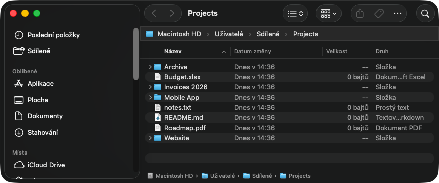

# Adresní řádek pro Finder (macOS)

[English](README.md) · **Čeština**

**Editovatelný adresní řádek pro Finder v macOS**, jaký znáte z Průzkumníka ve Windows. Každé okno Finderu dostane pod panelem nástrojů řádek s celou cestou k aktuální složce. Kliknete do něj, napíšete nebo vložíte cestu, stisknete Enter a okno na ni přejde.



> ⭐ **Pokud vám to usnadnilo práci, budeme rádi za hvězdičku.** Jinak se nedozvíme, že to někomu k něčemu je.

## K čemu to je

Finder ukáže, kde jste, ale nedovolí jednoduše napsat, kam chcete. Vestavěné *Přejít do složky* (⇧⌘G) je dialog, který musíte pokaždé otevřít, a řádek cesty dole v okně se nedá upravovat. Kdo přešel z Windows nebo celý den kopíruje cesty z terminálu, chatu a dokumentace, tomu adresní řádek chybí.

## Co umí

- Celá cesta každého okna Finderu je pořád vidět a mění se podle toho, kam přejdete.
- Kliknutí označí celou cestu, napíšete nebo vložíte novou a **Enter** na ni přejde.
- **Tab** doplňuje názvy složek, **Esc** úpravu zruší.
- Rozumí `~`, relativním cestám (`..`, `podslozka`), adresám `file://`, cestám v uvozovkách i cestám zapsaným pro shell (`Moje\ složka`).
- Cesta k souboru ho otevře ve výchozí aplikaci, cesta k aplikaci ji spustí.
- Webové adresy se otevřou v prohlížeči: cokoli, co začíná `https://` nebo `http://`, a také `www.…` nebo běžná doména jako `seznam.cz`, pokud neexistuje soubor toho jména. Jiné adresy (`smb://`, `mailto:` …) se otevřou v aplikaci, která je obsluhuje.
- Každé okno má vlastní řádek, který se s oknem přesouvá a mění velikost.
- Ikona v řádku nabídek nabízí umístění (pod panelem nástrojů, nebo dole místo řádku cesty Finderu), jemný posun, spouštění po přihlášení, aktualizace a ukončení.
- Sama se aktualizuje z vydání tohoto projektu, viz [Aktualizace](#aktualizace).
- Rozhraní je česky a anglicky.
- Žádná injektáž kódu, ochrana SIP zůstává zapnutá a není potřeba oprávnění Zpřístupnění ani Nahrávání obrazovky. Jediné oprávnění je *Automatizace → Finder*.

## Požadavky

- macOS 13 nebo novější, Apple silicon i Intel. Vyvíjeno a zkoušeno jen na macOS 26 (Tahoe); na jiných verzích může řádek sedět o pár bodů vedle, viz [Doladění](#doladění).

## Instalace

### Nejjednodušeji: jedním příkazem

Otevřete **Terminál** (stiskněte ⌘Mezerník, napište `Terminál`, stiskněte Enter), vložte tento řádek a stiskněte Enter:

```bash
curl -fsSL https://raw.githubusercontent.com/Thominho/finder-address-bar/main/install.sh | bash
```

Příkaz aplikaci stáhne, uloží do složky Aplikace a spustí. Nic se nesestavuje a Xcode není potřeba. Od verze 1.2 se aplikace aktualizuje sama, takže to stačí udělat jednou.

### Stažení

1. Stáhněte **[FinderPathBar.zip](https://github.com/Thominho/finder-address-bar/releases/latest/download/FinderPathBar.zip)** a dvojklikem ho rozbalte.
2. Přetáhněte `FinderPathBar` do složky Aplikace a otevřete ho.
3. macOS ho napoprvé odmítne otevřít, protože aplikace není notarizovaná u Applu (k tomu je potřeba placený vývojářský účet). Otevřete **Nastavení systému → Soukromí a zabezpečení**, sjeďte dolů ke zprávě o FinderPathBar a klikněte na **Přesto otevřít**. Stačí to udělat jednou.

Instalace jedním příkazem výše na tohle nenarazí.

### Sestavení ze zdrojového kódu

Potřebujete Xcode nebo Command Line Tools (`xcode-select --install`).

```bash
git clone https://github.com/Thominho/finder-address-bar.git
cd finder-address-bar
./build.sh
open FinderPathBar.app
```

### První spuštění

1. Aplikace nabídne dvě volby, obě zaškrtnuté. Nechte je tak a klikněte na **Pokračovat**:
   - **Vyhradit ve Finderu řádek**: Finder pak pod panelem nástrojů drží prázdný řádek (řádek panelů) a adresní řádek leží přesně na něm, takže nic nezakrývá. Nová okna Finderu ho dostanou automaticky; v oknech, která už jsou otevřená, jednou zvolte **Zobrazení → Zobrazit řádek panelů**.
   - **Spouštět po přihlášení**: jinak řádek po restartu zmizí, dokud aplikaci znovu neotevřete.
2. macOS se zeptá, jestli smí FinderPathBar **ovládat Finder**. Povolte to, jinak aplikace nezjistí ani nezmění složku, kterou okno zobrazuje.
3. V řádku nabídek se objeví ikona složky. Všechno ostatní je v její nabídce.

Bez vyhrazeného řádku adresní řádek funguje taky, jen v zobrazení seznamu leží přes záhlaví sloupců a v ostatních zobrazeních přes horní část první položky.

## Jak to funguje

Finder nejde rozšířit o skutečný řádek v panelu nástrojů, takže jde o malou aplikaci na pozadí, která si řádek kreslí sama:

1. Přes AppleScript se Finderu ptá, která okna jsou otevřená a jakou složku zobrazují.
2. Polohu oken čte z window serveru.
3. Přes každé okno Finderu položí panel bez rámečku a drží ho nad tím oknem, takže vypadá jako součást okna.
4. Po stisku Enteru řekne Finderu, aby dané okno přepnul na novou složku. Soubory a webové adresy předá aplikaci, která je otevře.

## Aktualizace

Při spuštění a pak každých šest hodin se aplikace podívá na nejnovější vydání tohoto repozitáře. Když najde novější verzi, stáhne ji, ověří, že jde o stejnou aplikaci v ohlášené verzi s neporušeným podpisem, nahradí se a znovu spustí. Pokud zrovna píšete do řádku, počká.

- Volba **Automaticky aktualizovat** v nabídce u ikony v řádku nabídek to vypne.
- **Zkontrolovat aktualizace…** zkontroluje hned a řekne výsledek.
- Verze 1.0 a 1.1 se samy aktualizovat neumí. Spusťte instalační příkaz ještě jednou a dostanete 1.2; od ní už aktualizace probíhají samy.
- Aplikace se umí nahradit jen tam, kam smí zapisovat, což ve složce Aplikace normálně platí.

## Doladění

Volby **Posunout o bod výš** a **Posunout o bod níž** v nabídce řádek posunou, pokud nesedí.

Rozměry se dají změnit příkazem `defaults`, například:

```bash
defaults write local.finderpathbar toolbarHeight -float 52
```

| Klíč | Výchozí | Význam |
| --- | --- | --- |
| `toolbarHeight` | 52 | Výška panelu nástrojů Finderu |
| `titlebarHeight` | 28 | Výška záhlaví okna, když je panel nástrojů skrytý |
| `barHeight` | 28 | Výška adresního řádku |
| `sidebarGap` | 8 | Mezera mezi bočním panelem a oblastí se soubory |
| `pathBarHeight` | 30 | Výška řádku cesty Finderu (umístění dole) |
| `statusBarHeight` | 28 | Výška stavového řádku Finderu (umístění dole) |
| `windowCornerRadius` | 26 | Zaoblení rohu okna (umístění dole) |

Když se něco chová divně, příkaz `defaults write local.finderpathbar debug -bool true` zapne výpis toho, co aplikace dělá (viz aplikace Konzole).

## Když něco nefunguje

- **Po restartu řádek zmizel.** Aplikace neběží. Otevřete FinderPathBar ze složky Aplikace a v nabídce u její ikony v řádku nabídek zapněte **Spouštět po přihlášení**.
- **Řádek je vidět, ale neukazuje cestu.** FinderPathBar nemá povolení ovládat Finder. Povolte ho v **Nastavení systému → Soukromí a zabezpečení → Automatizace**.

## Omezení

- Je to překryv, takže se při tažení nebo změně velikosti okna o zlomek vteřiny opožďuje.
- Když má okno víc panelů, vyhrazený řádek zabere lišta panelů Finderu. V takovém okně se adresní řádek přesune dolů, přes řádek cesty Finderu.
- Tlačítko **+** pro nový panel je pod řádkem schované. ⌘T funguje dál.
- Zkoušeno na macOS 26 s výchozím panelem nástrojů Finderu. Jiné verze a styly panelu můžou potřebovat doladění popsané výše.

## Odinstalace

V nabídce u ikony v řádku nabídek vypněte **Spouštět po přihlášení**, aplikaci ukončete a smažte. Pokud nechcete prázdný řádek, zvolte ve Finderu **Zobrazení → Skrýt řádek panelů**. Nastavení odstraníte takto:

```bash
defaults delete local.finderpathbar
```

## Licence

[MIT](LICENSE)

---

⭐ **Usnadnilo vám to práci? Hvězdička u tohoto repozitáře nás potěší.**
